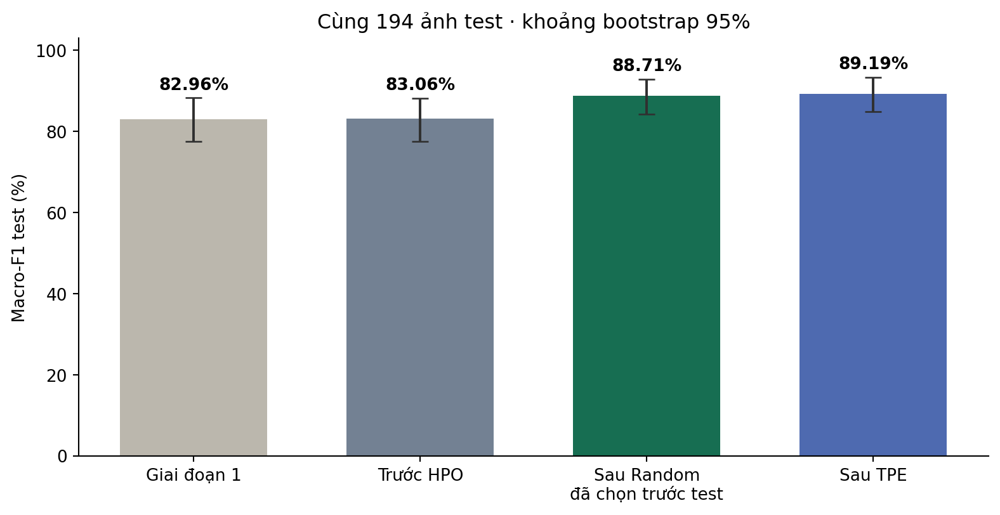
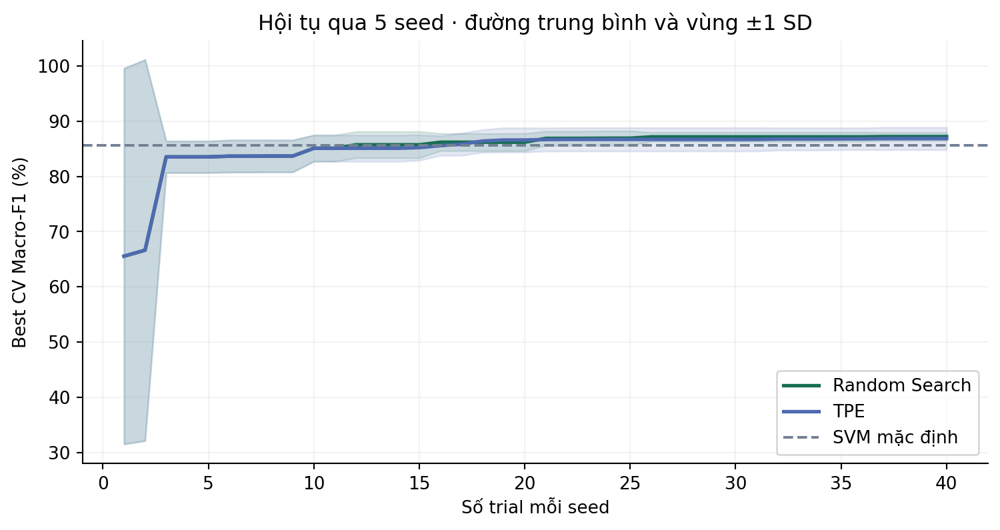

# Tối ưu SVM trong nhận diện cây dược liệu qua ảnh lá

**Học máy có giám sát — Random Search và TPE với ngân sách bằng nhau.**
Huỳnh Gia Huy · Bài tập lớn tối ưu hóa · Thực nghiệm 27–28/10/2026.

Đã huấn luyện trên BDMediLeaves **6 loài**. Pipeline: HSV + LBP đa tỉ lệ + GLCM (126 đặc trưng) → StandardScaler → SVM. Tối ưu nâng Macro-F1 từ **83,06% lên 88,71%** trên cùng 194 ảnh test giữ riêng. Đây là kết quả trong bộ dữ liệu, chưa phải độ chính xác ngoài thực tế.

## Trước và sau tối ưu

| Mô hình cùng 126 đặc trưng | Macro-F1 test | Accuracy test | Đúng / 194 |
|---|---:|---:|---:|
| SVM mặc định | 83,06% | 82,99% | 161 |
| **Random Search được chọn** | **88,71%** | **88,66%** | **172** |
| TPE đối chứng | 89,19% | 89,18% | 173 |

Mức tăng chính **+5,65 điểm phần trăm Macro-F1**, khoảng bootstrap ghép cặp 95% **[+2,01; +9,76]** điểm phần trăm. Sửa 13 lỗi, phát sinh 2 lỗi mới. Khoảng này có điều kiện theo holdout hiện tại, không chứng minh khả năng tổng quát sang cây/phiên chụp mới.



**Vì sao giữ Random Search?** Quy tắc đã khóa trước test: chọn phương pháp bằng trung bình best-CV qua 5 seed, rồi chọn cấu hình best-CV của phương pháp đó. Random đạt 87,21% ± 0,76 điểm phần trăm; TPE 86,85% ± 2,03. TPE hơn một ảnh test không được dùng để chọn lại mô hình. Số ± là SD mẫu giữa seed, không phải khoảng tin cậy hay các bộ dữ liệu độc lập.

## Chạy trên Windows

Cài Python 3.12, mở PowerShell tại thư mục README. Không cần GPU.

```powershell
py -3.12 -m venv .venv
.\.venv\Scripts\python.exe -m pip install -r requirements.txt
.\.venv\Scripts\python.exe -m src.predict "C:\duong_dan\anh_la.jpg" --compare
.\.venv\Scripts\python.exe -m unittest discover -s tests -v
```

Mô hình đã học nằm ở `models/baseline.joblib` và `models/optimized.joblib`; không cần tải dữ liệu để dự đoán ảnh của bạn. Chỉ nạp joblib từ nguồn tin cậy. Đầu ra là nhãn trong sáu lớp, không có xác suất hiệu chỉnh hay cơ chế phát hiện loài lạ.

Linux/macOS: tạo môi trường bằng `python3 -m venv .venv`; dùng `.venv/bin/python` thay đường dẫn Python Windows.

## Tái lập

Với môi trường đã cài requirements, chạy từ thư mục gốc:

```bash
python -m src.reproduce --out results/reproduction_01
```

Lệnh tải archive khoảng 60 MB và kiểm tra SHA-256, dùng manifest cố định, chạy 5 thử nghiệm đặc trưng, 400 trial HPO, lưu mô hình và chấm test một đợt trong thư mục mới. Không ghi đè kết quả gốc. Không dùng nhiều lần tái lập để chọn test thuận lợi nhất. Thời gian phụ thuộc CPU; trích đặc trưng tốn phần lớn thời gian.

Nếu tải tự động thất bại, lấy **Non Augmented Images-.zip** tại [nguồn chính thức](https://data.mendeley.com/datasets/t9rns2gmr3/1), đặt vào `data/source/originals.zip`, chạy lại. Kiểm tra riêng bước kiểm toán:

```bash
python -m src.download
python -m src.audit --images data/raw --out data/audit_recheck
```

SHA-256 manifest: `5a352a09cef2b6a84855fa1a23b64f5032f6c4c3e47e154600eec4e06f3b33ff`.
Notebook `notebooks/So_sanh_truoc_sau_toi_uu.ipynb` đọc kết quả đã lưu; Run All không huấn luyện hoặc mở lại test.

## Dữ liệu và chống rò rỉ

- BDMediLeaves 6 loài, DOI **10.17632/t9rns2gmr3.1**, CC BY 4.0; khác bản 10 loài.
- 1.217 ảnh đọc được; bỏ 245 bản trùng điểm ảnh → 972 ảnh. 31/121 ảnh test gốc trùng train gốc nên không dùng cách chia nguồn.
- pHash dưới phép quay/lật tìm một cặp gần trùng, giữ cùng nhóm; tổng 971 nhóm.
- 778 ảnh development; 194 ảnh test / 193 nhóm. Ba fold nhóm cố định trên development; StandardScaler fit trong mỗi fold.
- Không có ID cây/lá/phiên chụp; nhóm chỉ là heuristic. Có tên tệp chứa `augmented` trong archive Non Augmented, nên không khẳng định ảnh camera chưa xử lý.

## Bài toán tối ưu

Biến x=(kernel,C,gamma): kernel ∈ {linear,rbf}; C log[10⁻³,10³]; gamma log[10⁻⁵,10⁻¹] khi RBF. Mục tiêu tối thiểu hóa f(x)=1−mean CV Macro-F1 trên 3 fold.

Mỗi phương pháp **40 trial × 5 seed** {11,29,47,71,101}: tổng 400 trial / 1.200 CV fit, không tính ablation, baseline và refit. TPE khởi động ngẫu nhiên 10 trial; không pruning; n_jobs=1; BLAS/OMP=1. Đây là tối ưu siêu tham số bên ngoài; bộ giải SVM học trọng số/support vector trong từng lần fit.

| Phương pháp | Mean best-CV | SD giữa seed | Giây / 40 trial |
|---|---:|---:|---:|
| Random Search | 87,21% | 0,76 điểm % | 3,18 |
| TPE | 86,85% | 2,03 điểm % | 3,19 |

Thời gian đo trên CPU với đặc trưng đã cache, không gồm tải/trích ảnh; không cam kết tốc độ trên máy khác. Cấu hình chọn: **RBF, C=13.28777377006487, gamma=0.006029953818540779**, seed 101, trial 24. Hai mô hình bàn giao chỉ học 778 ảnh development.



## Hướng phát triển đã kiểm tra

Năm bộ mô tả, cùng SVM mặc định và fold: v1 HOG+HSV+LBP (958 chiều, CV 75,21%); bỏ màu (910, 71,50%); texture128 (126, **85,63%**); thêm HOG 128 px (1.890, 78,04%); crop giữa 80% rồi thêm HOG (1.890, 78,50%). Chọn texture128 bằng development.

Test của v1 mặc định là 82,96% Macro-F1, gần baseline texture128 83,06%. Mức tăng khoảng 10 điểm CV khi đổi đặc trưng **không tương đương tăng 10 điểm test**. So sánh HPO chính giữ cùng 126 đặc trưng.

## Tệp cần đọc

| Tệp | Nội dung |
|---|---|
| `report/Bao_cao_SVM_thao_duoc.docx` và `.pdf` | Báo cáo cuối |
| `report/Tom_tat_bao_ve_SVM.docx` và `.pdf` | Tóm tắt bảo vệ một trang |
| `docs/PHASE2_PROTOCOL.md` | Quy tắc ghi trước thí nghiệm |
| `data/audit/manifest.csv` | Hash, nhóm, tập và fold |
| `results/phase2/hpo/trials.csv` và `.jsonl` | Toàn bộ 400 trial |
| `results/phase2/final/frozen_selection.json` | Lựa chọn đóng băng trước test |
| `results/phase2/evaluation/` | Dự đoán 194 ảnh, metrics, bootstrap |
| `results/phase2/figures/` | Ablation, hội tụ, biến thiên, confusion matrix, lỗi |
| `models/metadata.json` | Hash hai mô hình bàn giao |
| `docs/MODEL_CARD.md` | Phạm vi và hướng học sâu |
| `docs/DEVELOPMENT_HISTORY.md` | Tiến độ thực tế, không lùi ngày commit |

Kiểm tra tự động: không trùng pixel/nhóm giữa tập; cache chỉ development; hash mã/manifest; ngân sách trial; tính lại metrics; bảo vệ không chấm lại test; nhất quán mô hình bàn giao. Bản clone không có cache/trọng số pilot sẽ bỏ qua kiểm tra phụ thuộc các tệp đó. Log trong `results/phase2/`.

JSONL từng thiếu 6 dòng khi khôi phục phiên; CSV còn đủ 400. Đã đối chiếu 394 dòng, tính lại 18 fold của 6 trial thiếu (sai số ≤10⁻¹²), rồi phục hồi JSONL. Không thêm trial hoặc đổi lựa chọn. Bằng chứng: `results/phase2/hpo/log_integrity_recovery.json`.

## Giới hạn và hướng tiếp theo

Train Macro-F1 sau tối ưu 100%, test 88,71%: vẫn có khoảng cách tổng quát hóa. Dữ liệu nhỏ, nền/màu ảnh tham gia đặc trưng; chưa kiểm thử độc lập trên ảnh Việt Nam hoặc loài lạ. Không dùng dự đoán để quyết định sử dụng cây làm thuốc.

Tiếp theo: thu ảnh theo cây/phiên chụp, kiểm định nhãn, giữ test ngoài miền; so sánh segmentation trên development mới. Có thể dùng đặc trưng CNN tiền huấn luyện + SVM rồi fine-tune MobileNet/EfficientNet. **Chưa huấn luyện học sâu trong dự án này.** Test hiện tại đã mở, không còn là tập kín cho thiết kế mới.

Có hỗ trợ AI trong nghiên cứu, viết mã và kiểm tra. Sinh viên cần tự chạy, hiểu thuật toán và xác minh trước khi nộp. Checkpoint git thực hiện trong hai ngày **không thay thế lịch sử 5 tuần**. Báo cáo giai đoạn 1 là tài liệu lịch sử.

## Nguồn và giấy phép

Islam, Saiful và cộng sự (2023), **BDMediLeaves**, Mendeley Data V1, [DOI 10.17632/t9rns2gmr3.1](https://doi.org/10.17632/t9rns2gmr3.1), [CC BY 4.0](https://creativecommons.org/licenses/by/4.0/). Thay đổi: lọc trùng, gán nhóm, chia lại tập, resize, trích đặc trưng; không hàm ý tác giả nguồn bảo chứng kết quả.

Mã dự án: [MIT](LICENSE). Ảnh minh họa vẫn theo CC BY 4.0. [Tài liệu tham khảo](docs/REFERENCES.md).
