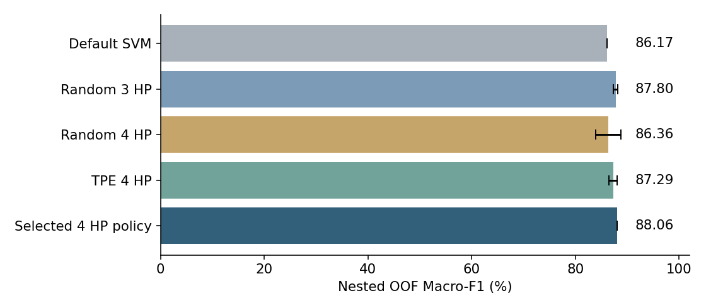

# Tối ưu SVM nhận diện cây dược liệu v0.3

Huỳnh Gia Huy · 2474802010135 · Đại học Văn Lang · 03/11/2026.

Học máy có giám sát trên **sáu lớp ảnh lá BDMediLeaves**, chạy CPU. HSV + LBP + GLCM tạo 126 đặc trưng → StandardScaler → SVM. Bản v0.3 đã tìm **4 siêu tham số**: kernel, C, gamma có điều kiện và class_weight; có mô hình học sẵn, CLI, API cục bộ, notebook, báo cáo và lịch sử Git.

## Kết quả mới và phạm vi

| Nested OOF trên 778 ảnh development cũ | Macro-F1 | Accuracy | Đúng |
|---|---:|---:|---:|
| SVM mặc định | 86,17% | 86,12% | 670 |
| Chính sách chọn cấu hình 4 tham số | **88,06%** | **88,05%** | **685** |

Tăng **1,89 điểm phần trăm Macro-F1**; sửa 34 lỗi, phát sinh 19 lỗi. Đây là điểm đánh giá chính sách tìm kiếm/refit ở các outer fold, không phải điểm test mới của một mô hình refit duy nhất. Biểu diễn đã được chọn trên development trong lịch sử; nhóm chỉ dựa trên ảnh trùng/gần trùng, chưa phải ID cây. Chưa có đánh giá ngoài miền tại Việt Nam.



| Search cùng 40 trial/seed | Mean nested OOF qua 5 seed | SD giữa seed |
|---|---:|---:|
| Random3 | 87,80% | 0,42 điểm % |
| Random4 | 86,36% | 2,44 điểm % |
| TPE4 | 87,29% | 0,83 điểm % |

**Chưa chứng minh thêm tham số thứ tư làm chất lượng tốt hơn ổn định.** Chính sách selected4 chọn qua năm seed và hai phương pháp, nên có tổng ngân sách khác một seed ở bảng này. Cấu hình bàn giao chọn bằng inner CV toàn development: **TPE4, RBF, C=6.602593199343702, gamma=0.005818740333111208, class_weight=None**. None là kết quả tìm kiếm hợp lệ.

Test lịch sử 194 ảnh vẫn giữ nguyên: Macro-F1 baseline 83,06%, Random3 được chọn 88,71%, TPE3 đối chứng 89,19%. **Không chấm lại test đó cho v0.3.** Không so trực tiếp 88,71% test cũ với 88,06% nested OOF như một mức tăng/giảm. Xem [báo cáo toàn dự án](report/Bao_cao_toan_bo_du_an_thao_duoc_v0_3.pdf).

## Chạy ngay trên Windows

Cài Python 3.12 và mở PowerShell trong thư mục README:

```powershell
py -3.12 -m venv .venv
.\.venv\Scripts\python.exe -m pip install -r requirements-api.txt
.\.venv\Scripts\python.exe -m src.predict examples/centella_development.jpg --compare
.\.venv\Scripts\python.exe -m unittest discover -s tests -v
.\.venv\Scripts\python.exe -m uvicorn src.service:app --host 127.0.0.1 --port 8000
```

Mở `http://127.0.0.1:8000/docs` để thử API: GET `/health`, POST `/predict`, chọn file ảnh lá. Không cần tải dataset để chạy CLI/API. Ảnh ví dụ thuộc development, chỉ dùng smoke test, có ghi công tại `examples/ATTRIBUTION.json`.

Linux/macOS: tạo venv bằng `python3 -m venv .venv`; dùng `.venv/bin/python` thay đường dẫn Windows. Nếu chỉ cần CLI/huấn luyện, cài `requirements.txt`; API dùng `requirements-api.txt`. `requirements-artifacts.txt` dành cho tạo báo cáo/notebook.

API nhận JPEG/PNG/WEBP, tối đa 10 MB và 20 triệu pixel. `organ=leaf` là loại đầu vào duy nhất được hỗ trợ; hệ thống chưa tự phát hiện cơ quan. API trả nhãn và decision score, **không phải xác suất đúng**; chưa phát hiện loài ngoài sáu lớp. Không dùng kết quả để quyết định sử dụng cây làm thuốc. Chỉ nạp joblib từ nguồn tin cậy.

## Thí nghiệm và tái lập

Giao thức: [PHASE3_PROTOCOL.md](docs/PHASE3_PROTOCOL.md). Năm outer fold, ba inner fold theo nhóm; 40 trial x 5 seed {11,29,47,71,101} cho mỗi Random3/Random4/TPE4. Tổng **3.600 trial / 10.800 inner CV fit**, thêm baseline và refit được ghi riêng. TPE khởi động 10 trial, không pruning, n_jobs=1 và một luồng BLAS/OMP.

Để tái lập trong workspace riêng, giữ mô hình bàn giao:

```powershell
$env:OPENBLAS_NUM_THREADS="1"
$env:OMP_NUM_THREADS="1"
.\.venv\Scripts\python.exe -m src.reproduce_v03 --out results/reproduction_v03_01
```

Lệnh tải archive đã xác minh SHA-256 nếu chưa có, chỉ dùng development, chạy toàn bộ tìm kiếm và lưu trọng số mới dưới thư mục tái lập. Không chấm lại test lịch sử. Dùng đường dẫn mới cho mỗi run. Cài đúng phiên bản để giảm sai khác; thời gian phụ thuộc CPU. `src.phase3` là runner nội bộ, mặc định chỉ dùng cho lần chạy release mới.

Tái lập giai đoạn 2 lịch sử trong clone riêng: `python -m src.reproduce --out results/reproduction_phase2_01`. Không dùng việc chạy lại để chọn một kết quả test thuận lợi.

## Mở rộng cây dược liệu Việt Nam

[Hồ sơ nghiên cứu](research/vietnam/Nghien_cuu_chon_du_lieu_thao_duoc_VN.md) có 20 ứng viên, ưu tiên rau má, diếp cá, tía tô, húng chanh, lá lốt, trầu không, lô hội, thuốc bỏng, cỏ nhọ nồi, xuyên tâm liên, ích mẫu và râu mèo. Đây là phạm vi thu thập, **chưa phải 12 lớp đã huấn luyện**.

Metadata TDTU cho 69 ứng viên theo tên; sàng lọc 18 ảnh có chủ đích phát hiện 8 ảnh nghi nhãn không phù hợp và một cặp trùng byte mang hai nhãn. Mẫu này không đại diện để ước lượng lỗi toàn dataset. Các ảnh hiện chưa hoàn tất định danh/quyền sử dụng.

Bộ kiểm tra mới chặn nhãn chưa xác minh, thiếu giấy phép, ghép ảnh khác cây, rò rỉ theo cây/quan sát và hash ảnh thay đổi:

```powershell
.\.venv\Scripts\python.exe -m src.curation validate --input research/vietnam/annotation_records_v0_1.json --multi-organ --out results/vietnam_readiness_recheck.json
```

Kết quả hiện tại là cấu trúc hợp lệ nhưng **ready_for_training=false**, 0 train_keep. Mã thoát 2 báo chưa sẵn sàng, không phải lỗi cần bỏ qua. Muốn kiểm tra file ảnh thật, bổ sung `image_path`, hash và `--images-root`. Thu nhiều bộ phận phải cùng cá thể/khóm; tuổi để null khi không có nhật ký gieo/trồng. Mục tiêu thu thập 30–50 nhóm độc lập/loài là đề xuất, không phải lượng ảnh hiện có.

## Tệp chính

| Tệp | Nội dung |
|---|---|
| `models/phase3_optimized.joblib`, `phase3_metadata.json` | Trọng số v0.3, tham số và hash |
| `models/baseline.joblib`, `optimized.joblib` | Mốc giai đoạn 2 |
| `results/phase3/protocol.json` | Ngân sách và hash trước trial đầu |
| `results/phase3/trials.jsonl` | 3.600 trial gốc |
| `results/phase3/nested_predictions.csv` | 778 dự đoán outer OOF và đối chứng |
| `results/phase3/nested_evaluation.json` | Chỉ số, per-class, confusion và bootstrap chẩn đoán |
| `notebooks/Ket_qua_du_an_v0_3.ipynb` | Notebook kết quả, Run All không huấn luyện |
| `report/Bao_cao_toan_bo_du_an_thao_duoc_v0_3.*` | Báo cáo toàn dự án Word/PDF/Markdown |
| `report/Tom_tat_bao_ve_v0_3.*` | Tóm tắt bảo vệ một trang |
| `docs/GITHUB_UPLOAD.md` | Tự push repo, bảo toàn lịch sử bằng bundle |
| `research/vietnam/` | Loài, schema nhãn, quyết định ảnh và kiểm tra nhập liệu |

Kiểm tra cục bộ gồm 25 test, 21 đạt và 4 bỏ qua có lý do vì cache/trọng số lịch sử không đóng gói. CI GitHub đã cấu hình, cần xem run thật sau khi push. Xem [model card](docs/MODEL_CARD.md) và [release notes](docs/RELEASE_NOTES_v0_3.md).

## Nguồn và giấy phép

Mã dự án MIT. BDMediLeaves: Islam, Saiful và cộng sự (2023), [DOI 10.17632/t9rns2gmr3.1](https://doi.org/10.17632/t9rns2gmr3.1), CC BY 4.0; đổi tên ví dụ, lọc trùng, gán nhóm, chia lại tập và trích đặc trưng không hàm ý tác giả nguồn bảo chứng kết quả. Các dữ liệu nghiên cứu Việt Nam giữ giấy phép riêng, xem [SOURCES.md](research/vietnam/SOURCES.md).

Có hỗ trợ AI trong nghiên cứu, viết mã và kiểm tra. Sinh viên cần tự chạy và hiểu thuật toán. Lịch sử commit giữ đúng ngày thực tế, không thay thế yêu cầu thực hiện trong năm tuần. Bản này chuẩn bị để người dùng tự đưa lên GitHub; chưa publish repo hoặc website công cộng.
