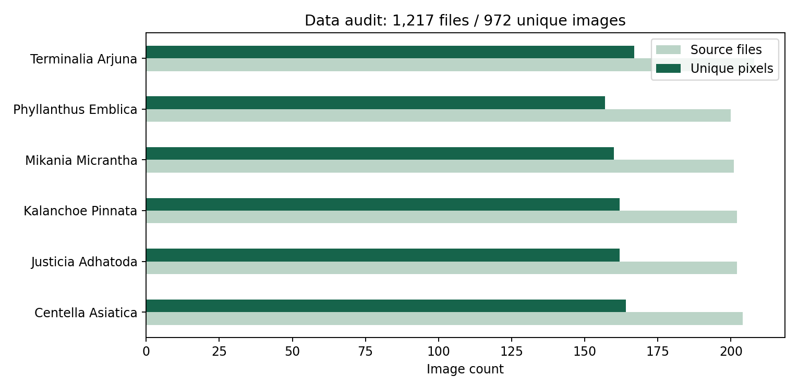
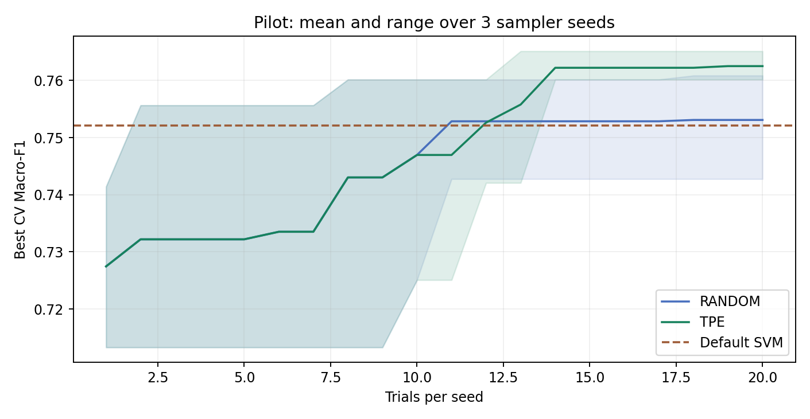
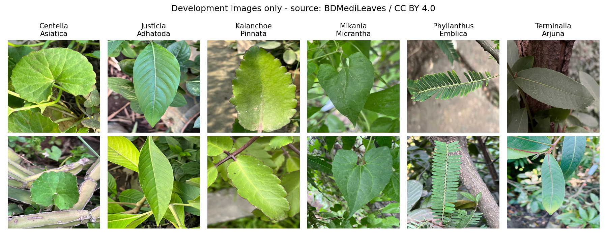

# Nhận diện cây dược liệu qua ảnh lá

Giai đoạn 1 - Nghiên cứu nguồn dữ liệu và thí nghiệm SVM ban đầu | 27/10/2026

## Đề tài và câu hỏi nghiên cứu

Tên đề tài đề xuất: Tối ưu siêu tham số SVM trong nhận diện cây dược liệu qua ảnh lá bằng Random Search và TPE.

Câu hỏi chính: Với cùng dữ liệu, đặc trưng, cách kiểm định và số lần thử, TPE có tìm được cấu hình SVM tốt hơn Random Search hay không? Mức cải thiện có ổn định qua các seed và có đáng với thời gian tìm kiếm?

| Thành phần | Phạm vi giai đoạn hiện tại |
|---|---|
| Bài toán | Phân loại có giám sát, một ảnh thuộc một trong 6 loài đã biết. |
| Mô hình | HOG + HSV + LBP, chuẩn hóa đặc trưng và SVM. |
| Phần tối ưu | Tìm C, gamma và kernel; tối đa hóa Macro-F1 kiểm định chéo. |
| Kết quả đã làm | Kiểm toán 1.217 ảnh, lọc trùng, đóng băng tập dữ liệu, chạy 120 trial và kiểm tra mã. |
| Chưa đánh giá | 194 ảnh test độc lập với quá trình chọn tham số; học sâu và ảnh chụp tại Việt Nam. |

### Nghiên cứu liên quan

Naeem và cộng sự (2021) nghiên cứu phân loại lá dược liệu từ đặc trưng phổ và kết cấu bằng học máy [4]. Nguồn này được xác nhận ở mức thông tin bài và tiêu đề; chưa dùng số liệu của bài để đối chiếu.

Diwedi và cộng sự (2024; công bố trực tuyến năm 2023) kết hợp đặc trưng ResNet50 với SVM tối ưu [5]. Đây là hướng tham khảo để mở rộng sang học sâu, không phải mô hình đã triển khai trong pilot này.

Bergstra và Bengio (2012) đặt Random Search làm mốc so sánh cho tối ưu siêu tham số [6]. TPE chọn cấu hình mới dựa trên phân bố của những cấu hình có điểm tốt và phần còn lại [7]. Không có cơ sở để mặc định TPE luôn thắng trên bộ dữ liệu này.

## Dữ liệu: lựa chọn và kiểm toán

Chọn BDMediLeaves 6 loài, DOI 10.17632/t9rns2gmr3.1, giấy phép CC BY 4.0 [1]. Tệp do nguồn đặt tên Non Augmented Images-.zip có 60.027.147 byte; SHA-256 tải về khớp giá trị công bố. Không sử dụng archive ảnh tăng cường.

| Loài (nhãn nguồn) | Nguồn | Sau lọc | Dev | Test |
|---|---|---|---|---|
| Centella Asiatica | 204 | 164 | 132 | 32 |
| Justicia Adhatoda | 202 | 162 | 130 | 32 |
| Kalanchoe Pinnata | 202 | 162 | 129 | 33 |
| Mikania Micrantha | 201 | 160 | 128 | 32 |
| Phyllanthus Emblica | 200 | 157 | 125 | 32 |
| Terminalia Arjuna | 208 | 167 | 134 | 33 |
| Tổng | 1217 | 972 | 778 | 194 |

Tất cả ảnh đọc được; sau loại 245 bản trùng điểm ảnh còn 972 ảnh, kích thước 512 × 512. Có 93 nhóm trùng xuất hiện ở nhiều tập của nguồn; riêng 31/121 ảnh test gốc trùng với train gốc. Do đó pilot dùng cách chia mới sau lọc trùng, không so trực tiếp với điểm công bố trên split gốc.

Rà pHash 63 bit qua phép quay/lật phát hiện 1 cặp gần trùng; đã xem trực quan và gán cùng nhóm. Có 971 nhóm. Việc này không thay thế mã cây, mã lá hoặc mã phiên chụp do tác giả xác nhận.

## Thiết kế tối ưu và kiểm định

Vector quyết định x = (kernel, C, gamma); gamma chỉ có tác dụng trong nhánh RBF. Mục tiêu f(x) là trung bình Macro-F1 trên ba fold development. Tìm x có f(x) lớn nhất trong miền cho phép và giới hạn 20 trial cho mỗi phương pháp ở mỗi seed.

| Tham số / quy tắc | Giá trị đã cố định trước khi chạy |
|---|---|
| Kernel | linear hoặc rbf |
| C | Từ 0,001 đến 1.000; lấy mẫu theo thang log |
| Gamma (RBF) | Từ 0,00001 đến 0,1; lấy mẫu theo thang log |
| SVM mặc định | RBF, C = 1, gamma = scale |
| Seed bộ lấy mẫu | 11, 29, 47; TPE khởi động bằng 10 trial ngẫu nhiên |
| Ngân sách | 2 phương pháp × 3 seed × 20 trial = 120 trial; 363 CV fit gồm baseline |
| Đánh giá | Macro-F1 trung bình CV là mục tiêu duy nhất; thời gian là tiêu chí phụ |

### Từ ảnh sang đặc trưng

Ảnh được sửa hướng theo EXIF, đổi RGB và resize cố định 96 × 96. HOG tạo 900 đặc trưng hướng cạnh; ba histogram HSV tạo 48 đặc trưng màu; histogram LBP tạo 10 đặc trưng kết cấu. Tổng cộng 958 chiều [9]. Đây là đặc trưng tính riêng từng ảnh, không học từ toàn bộ dữ liệu.

StandardScaler và SVC nằm trong cùng Pipeline. Mỗi fold chỉ fit chuẩn hóa và SVM trên phần train của fold, rồi chấm trên phần validation [8]. Chưa tách vùng lá: đặc trưng cũng có thể chứa thông tin nền.

### Giữ phép so sánh công bằng

Sau khi lọc trùng, dùng StratifiedGroupKFold 5 phần với seed 2026; lấy phần đầu làm test (194 ảnh). Trên 778 ảnh còn lại, tạo 3 fold nhóm với seed 2027. Các fold và ảnh được ghi cố định trong manifest.csv; hai phương pháp dùng đúng cùng manifest.

Không pruning, không thay đổi miền tìm kiếm giữa hai phương pháp, không lấy điểm test làm mục tiêu. Ba seed đo biến thiên của quá trình tìm kiếm trên cùng split, không phải ba lần kiểm chứng độc lập ngoài mẫu. Sau khi chọn cấu hình bằng CV, chỉ refit một mô hình trên development; test vẫn chưa được chấm.

## Kết quả thử nghiệm thực tế

| Cấu hình / phương pháp | Seed | Macro-F1 CV tốt nhất |
|---|---|---|
| SVM mặc định | - | 0.7521 |
| Random Search | 11 | 0.7428 |
| Random Search | 29 | 0.7609 |
| Random Search | 47 | 0.7557 |
| TPE | 11 | 0.7623 |
| TPE | 29 | 0.7602 |
| TPE | 47 | 0.7651 |

Random Search: trung bình điểm tốt nhất qua ba seed = 0.7531; độ lệch chuẩn mẫu = 0.0093.

TPE: trung bình điểm tốt nhất qua ba seed = 0.7625; độ lệch chuẩn mẫu = 0.0025.

Cấu hình đơn tốt nhất là TPE seed 47: RBF, C ≈ 12,1662, gamma ≈ 0,0005504, Macro-F1 CV = 0,7651. So với baseline 0,7521, tăng khoảng 1,30 điểm phần trăm. Trung bình TPE cao hơn Random Search khoảng 0,94 điểm phần trăm.

Đây là kết quả chọn mô hình trên development, có thể lạc quan vì đã tìm nhiều cấu hình. Chưa có điểm test, chưa kiểm định ý nghĩa thống kê và chưa chứng minh TPE luôn tốt hơn. Thời gian tìm kiếm trung bình đo tại môi trường này: Random Search 6,18 giây/seed, TPE 7,16 giây/seed; không gồm trích đặc trưng.

## Tự đánh giá và kiểm tra

Quan sát mẫu: có nền phức tạp, nhiều lá trong cùng ảnh và bố cục khác nhau giữa loài. Vì dùng đặc trưng toàn ảnh, mô hình có thể dựa một phần vào nền hoặc hoàn cảnh chụp. Khả năng nhận diện lá ở môi trường mới vẫn cần kiểm chứng.

| Kiểm tra đã chạy | Kết quả |
|---|---|
| Ảnh trùng và nhóm không nằm ở hai phía split/fold | Đạt |
| Bộ đặc trưng pilot không chứa ảnh test; tất cả giá trị hữu hạn | Đạt |
| Theo dõi fit StandardScaler: chỉ nhận hàng train trong từng fold | Đạt |
| Checksum manifest khớp protocol và mô hình đã lưu | Đạt |
| Hai phương pháp có cùng ngân sách; điểm tổng hợp khớp trial log | Đạt |
| Trích lại đặc trưng và dự đoán bằng mô hình lưu cho cùng kết quả | Đạt |

Những kiểm tra này xác nhận quy trình và tính nhất quán của mã; không chứng minh nhãn thực vật học hoàn toàn đúng hoặc mô hình đã tổng quát tốt. Nguồn không cung cấp mã mẫu cây/lá; pHash có thể bỏ sót ảnh cùng một lá chụp ở góc khác.

Tên tệp vẫn có chữ augmented ngay trong archive mang tên Non Augmented. Vì vậy chỉ gọi đây là ảnh thuộc gói nguồn không tăng cường, không khẳng định ảnh thô chưa qua xử lý. Không suy diễn nhãn phân loại thành kết luận về công dụng thuốc.

Đánh giá khả thi: có thể tiếp tục đề tài trong phạm vi học máy và tối ưu. Điểm mạnh hiện tại là quy trình chống trùng và so sánh có kiểm soát; mức tăng điểm nhỏ nên bước tiếp theo cần tập trung phân tích lỗi, chất lượng ảnh và đặc trưng.

## Bước tiếp theo và nguồn tham khảo

1. Phân tích lỗi bằng dự đoán ngoài fold trên development: lớp hay nhầm, ảnh nền phức tạp, ảnh mờ. Xác minh thêm nhóm cùng cây hoặc phiên chụp nếu có thông tin.

2. Làm một so sánh loại bỏ thành phần: HOG + LBP so với HOG + HSV + LBP, cùng fold và ngân sách. Chỉ quyết định trên development. Nếu mở rộng ngân sách lên 30 hoặc 50 trial, ghi đó là thí nghiệm mới với hai phương pháp được tăng như nhau.

3. Chốt bộ đặc trưng, miền tìm kiếm và mô hình trước khi chấm 194 ảnh test trong một đợt cuối. Báo cáo Macro-F1, accuracy, confusion matrix và từng lớp. Không liên tục sửa mô hình theo test.

4. Mở rộng học sâu ở giai đoạn sau: dùng CNN có sẵn để trích đặc trưng rồi phân loại bằng SVM, hoặc fine-tune CNN. Giữ ảnh gốc, tên lớp và manifest để so sánh; bổ sung tập ảnh Việt Nam mới khi đánh giá triển khai.

Bộ bàn giao có mã Python, notebook, nhật ký CSV/JSON, biểu đồ, manifest và mô hình pilot. Chưa có kho GitHub công khai hay lịch sử làm việc 5 tuần; cần tạo các mốc tiến độ thật. Có hỗ trợ AI; người thực hiện phải tự tái lập và giải thích được kết quả.

### Nguồn đã đối chiếu ngày 27/10/2026

[1] Islam và cộng sự. BDMediLeaves, V1 (6 loài), 2023. CC BY 4.0. [Nguồn](https://data.mendeley.com/datasets/t9rns2gmr3/1)

[2] BDMediLeaves bản 10 loài, 2023: nguồn mô tả 2.029 ảnh gốc. Không dùng trong pilot. [Nguồn](https://data.mendeley.com/datasets/gk5x6k8xr5/1)

[3] Roopashree S, Anitha J. Medicinal Leaf Dataset, 2020. Mô tả số loài không thống nhất; chưa chọn. [Nguồn](https://data.mendeley.com/datasets/nnytj2v3n5/1)

[4] Naeem và cộng sự. The Classification of Medicinal Plant Leaves Based on Multispectral and Texture Feature Using Machine Learning Approach. Agronomy 11, 263 (2021). [Nguồn](https://doi.org/10.3390/agronomy11020263)

[5] Diwedi, Misra, Tiwari. CNN-based medicinal plant identification and classification using optimized SVM. Multimedia Tools and Applications 83 (2024). Đã đọc abstract của nhà xuất bản. [Nguồn](https://doi.org/10.1007/s11042-023-16733-8)

[6] Bergstra, Bengio. Random Search for Hyper-Parameter Optimization. JMLR 13 (2012). [Nguồn](https://jmlr.org/papers/v13/bergstra12a.html)

[7] Optuna 4.5.0, TPESampler: thuật toán và số trial khởi động. [Nguồn](https://optuna.readthedocs.io/en/v4.5.0/reference/samplers/generated/optuna.samplers.TPESampler.html)

[8] scikit-learn, Common pitfalls: Pipeline và data leakage. [Nguồn](https://scikit-learn.org/stable/common_pitfalls.html)

[9] scikit-image 0.25.2, Histogram of Oriented Gradients. [Nguồn](https://scikit-image.org/docs/0.25.x/auto_examples/features_detection/plot_hog.html)
